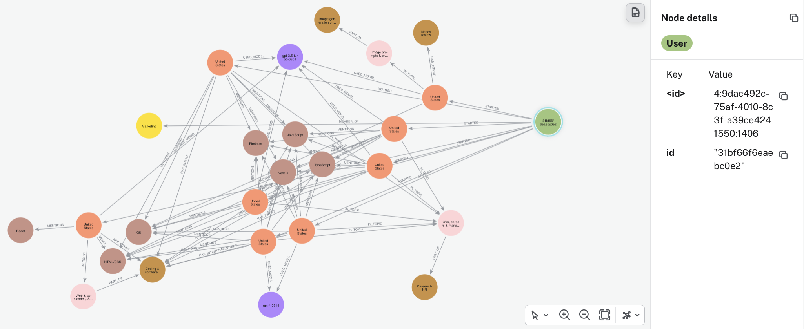
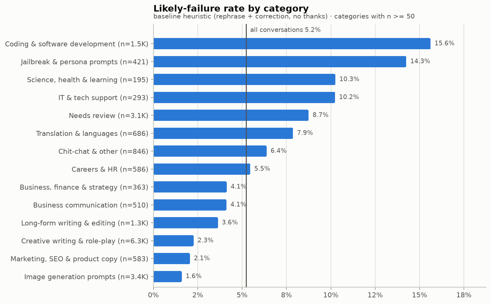

# What do people ask AI assistants for, and where does it fail them?

I grouped 20,000 real ChatGPT conversations by what users wanted done,
measured where the assistant fails them, and put the result in a Neo4j
knowledge graph that an AI agent can query over MCP.

**▶ [Watch the demo (1.5 min)](artifacts/demo.mov)**: Claude Code answers
"Where does the AI assistant fail its users most, and why?" from the graph
through the MCP tools.

| | |
|---|---|
| Data | **20,000** English conversations from **6,841** users (WildChat-1M) |
| Taxonomy | **30** k-means clusters → **13** intent categories |
| Classifier accuracy (held-out users) | **62%** overall · **72%** when it commits · 80–97% on templated categories |
| Biggest hotspot | **Coding fails 15.6%**, 3× the 5.2% baseline; **pandas 37%** |
| Knowledge graph | ~101k nodes · ~223k relationships · 9 MCP tools |

## How it was built

### 1. Data
I streamed 20,000 English conversations from
[WildChat-1M](https://huggingface.co/datasets/allenai/WildChat-1M) into DuckDB
and kept each conversation's **first user message** (what the user came for).
From the later turns I computed behaviour signals: did the user repeat the
request, reject the answer, or say thanks?

4,113 conversations repeat an earlier first message (one user pasted the same
prompt 272 times), so I clustered the **15,887 unique messages** only.

### 2. Clustering
I embedded the messages with `all-MiniLM-L6-v2` and clustered them with
k-means into **30 clusters**. These clusters are the basis for the taxonomy
and for classifying every conversation.

### 3. Taxonomy
I named each cluster by reading its messages, then grouped the 30 clusters into
**13 intent categories** (what the user wanted done, not the topic or fandom).
Two layers fix what embeddings miss:

- **Keyword rules** for code, image prompts and jailbreaks. I tested each rule
  against the data and dropped those that misfired. For example,
  `ignore previous instructions` hit creative-writing prompts in 40 of 45 cases.
- **A task layer** that detects *write / rewrite / translate* instructions, so
  "write an essay about management" goes to Long-form writing, not Careers.

Weak matches go to **Needs review** instead of being forced into a category.

### 4. Evaluation on held-out users
I tested on 5,000 conversations from users never seen in training, using 380
blind-labelled rows (100 random, plus 20 per category). The labels were made
by Claude following written rules (`gold/labelling_rules.md`), not by a person.

- **Accuracy 62%** (95% CI 52–71%); 72% when the classifier commits to a category.
- **Strong:** Image prompts 95% precision / 97% recall, Creative writing 80% / 92%, Coding 80% / 53%.
- **Weak:** Careers & HR (17% precision) and Science (8% recall). Implicit
  assignments ("Critically discuss…") and short factual questions are the main errors.

### 5. Knowledge graph and MCP server
I loaded everything into **Neo4j** (users, conversations, intents, topics,
tasks, 111 entities, models, turns, similar-conversation links, and a vector
index) and exposed it through a read-only **MCP server**. An agent can go from
a question to the evidence in a few calls:

`intent_overview` · `failure_hotspots` · `search_conversations` ·
`get_conversation` · `related` · `user_activity` · `classifier_reliability` ·
`graph_schema` · `graph_query`

*One user in Neo4j Browser (green, right) with their 8 conversations (orange)
and everything they link to: a student's web final project (Next.js, Firebase,
TypeScript). They came back 8 times and 5 of the conversations failed. Across
the data, a user whose coding conversation fails returns to coding in 101 of
148 cases, and **38.6% of those next conversations fail again**, against 15.6%
for coding overall. The long project brief pulled the embedding topic toward
"CVs, careers & management"; the keyword rules still put the intent in Coding.*

### 6. The graph exposed a flaw in my failure metric
Following the top hotspot ("Sports game scripts") through the graph, I found
one user asking for "write a <year> NBA season…" again and again, and every
request was answered. The rule was counting **iteration as failure**. A
labelled sample showed only 37% of its flags were real failures.

I rebuilt it to read how the user **reacts** to each reply (repeats the same
request, rejects the answer, comes back after a refusal, or the assistant
apologises for a mistake), then tested it blind on held-out users:

| | Old rule | New rule |
|---|---|---|
| Precision | 26% | **64%** |
| Real failures found (of 26) | 9 | **23** |

## Results

| Category | Conversations | Users | Failure rate | Est. manual hours |
|---|---|---|---|---|
| Creative writing & role-play | 6,267 | 914 | 2.3% | – |
| Image generation prompts | 3,379 | 1,528 | 1.6% | 563 |
| Needs review | 3,121 | 1,791 | 8.7% | – |
| **Coding & software development** | 1,485 | 781 | **15.6%** | 742 |
| Long-form writing & editing | 1,265 | 758 | 3.6% | 1,265 |
| Chit-chat & other | 846 | 612 | 6.4% | – |
| Translation & languages | 686 | 403 | 7.9% | 114 |
| Careers & HR | 586 | 429 | 5.5% | 293 |
| Marketing, SEO & product copy | 583 | 263 | 2.1% | 194 |
| Business communication | 510 | 354 | 4.1% | 128 |
| Jailbreak & persona prompts | 421 | 227 | 14.3% | – |
| Business, finance & strategy | 363 | 274 | 4.1% | 272 |
| IT & tech support | 293 | 197 | 10.2% | 98 |
| Science, health & learning | 195 | 123 | 10.3% | 65 |

**Findings**

1. **Coding fails users most: 15.6%, 3× the baseline.** The typical pattern is
   an error loop. Jailbreaks (14.3%) fail mostly through refusals, often correct ones.
2. **A few users can dominate a category.** One role-play cluster is 1,427
   conversations from 29 users, so I report distinct users next to every count.
3. **Most of the value is in writing and code:** 1,265 and 742 of about 3,700
   estimated manual hours.
4. **Needs review (15.6%) fails more often (8.7%)**, so I report it as its own
   group rather than dropping it.

### Asking the graph: live examples

Results from the MCP tools on the running graph:

**Which libraries fail most?** `failure_hotspots(by="entity")`

| Entity | Conversations | Failure rate | Lift |
|---|---|---|---|
| pandas | 78 | **37.2%** | 7.1× |
| NumPy | 67 | 29.9% | 5.7× |
| React | 36 | 25.0% | 4.8× |
| JavaScript | 100 | 19.0% | 3.6× |
